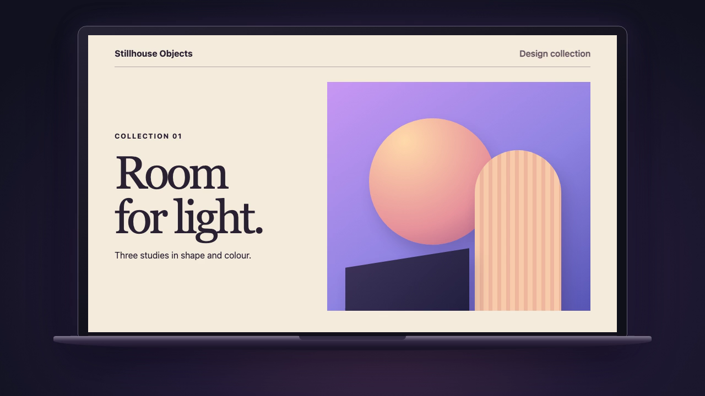

# Browser Clip

Browser Clip records a short scroll through a local web page, places it inside an original laptop frame, and exports an MP4 and poster. It runs entirely on your machine and includes a synthetic site you can record immediately.

[](docs/media/stillhouse.mp4)

## Quick start

Install Node.js 22 or newer and put `ffmpeg` and `ffprobe` on your PATH. Your FFmpeg build must include `libx264`. Homebrew's `ffmpeg` and Ubuntu's `ffmpeg` packages are suitable.

From a checkout or source archive:

```sh
npm ci
npx playwright install chromium --only-shell
npm run doctor
npm run demo
node bin/browser-clip.mjs validate browser-clip-output --duration 4
```

On a fresh Debian or Ubuntu machine, use `npx playwright install --with-deps chromium --only-shell` to install Chromium's system dependencies as well.

The demo writes three files into the new `browser-clip-output/` directory.

| File | Contents |
| --- | --- |
| `clip.mp4` | Silent 1280 × 720 H.264 video at 24 fps |
| `poster.png` | First frame at the full video resolution |
| `clip.json` | Dimensions, duration, frame count, codec and tool versions |

## Record your own page

Start your local development server, then point Browser Clip at its direct URL.

```sh
node bin/browser-clip.mjs record --url http://127.0.0.1:3000/ --duration 6 --output ./captures/intro
node bin/browser-clip.mjs validate ./captures/intro --duration 6
```

The viewport inside the frame is 960 × 540 CSS pixels and the output is 16:9. Duration is 2–12 whole seconds. A run holds the top of the page, scrolls smoothly to the bottom, then holds the last view. The output path must be new, which protects earlier exports.

## Scope

Browser Clip uses a fresh Chromium context for each recording. Bring a trusted page that you control at a literal HTTP loopback address (`127.0.0.1` or `[::1]`). The browser accepts same-origin GET and HEAD requests. It blocks other HTTP methods, cross-origin resources, HTTP redirects, service workers and WebSockets. Serve any required images or fonts from the local page's origin. Login-dependent pages, live streaming assets, interactive choreography, audio and other aspect ratios are outside this release.

Frame count and duration are fixed. Fonts, browser versions and live page state can change the appearance or output bytes across machines.

Run `npm test` to verify the local fixture, video output and capture behavior. See [Testing](docs/TESTING.md) and [Notices](NOTICE.md). Browser Clip source, original device artwork, the Stillhouse Objects fixture and its demo media use the [MIT License](LICENSE).
